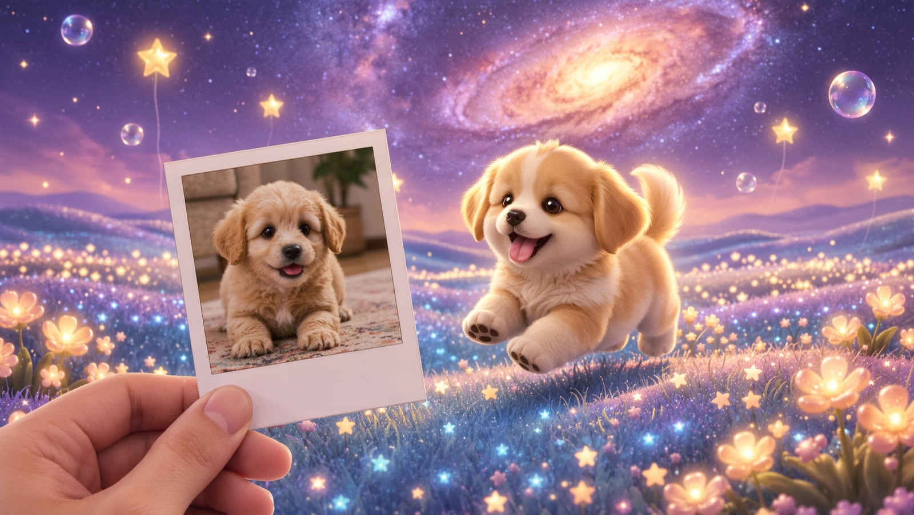
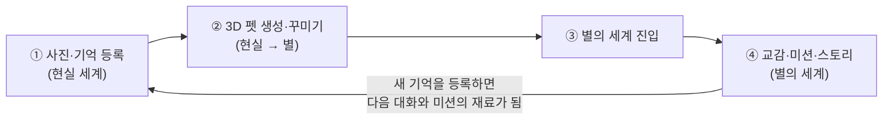
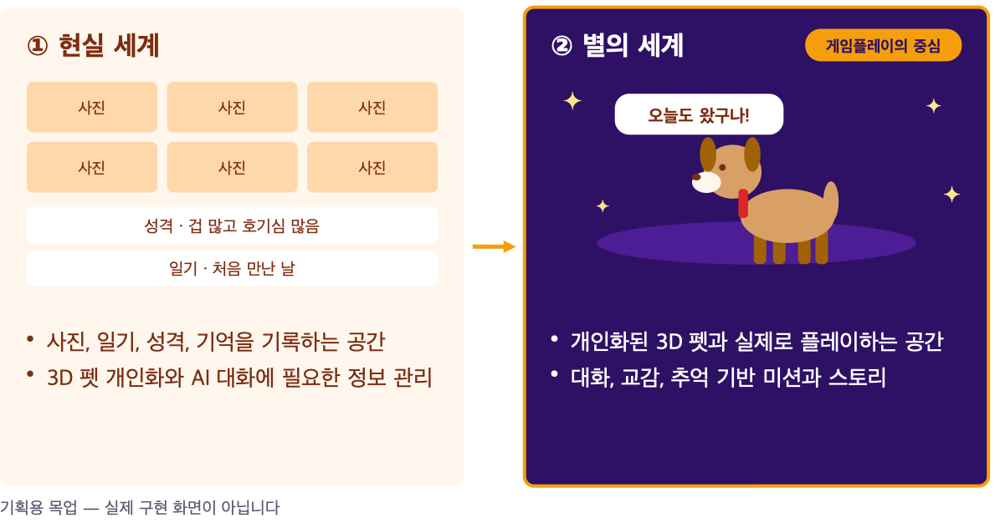
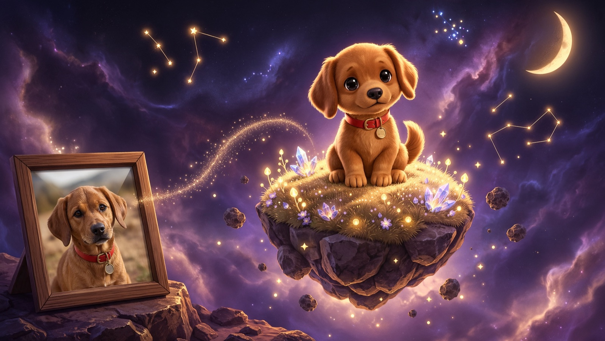
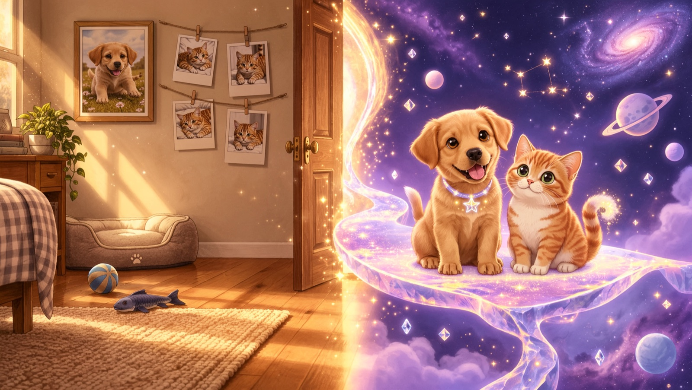

# Eternal Pet

AI 콘셉트 아트 (Canva 이미지 생성, 2026-11-20). 실제 게임 화면이 아닙니다.

> 반려동물의 사진과 추억으로 나만의 3D 펫을 만들고, 별의 세계에서 다시 만나 교감하며 모험하는 AI 기반 모바일 게임

**이 저장소는 게임 기획·시스템 설계 문서입니다. 프로토타입은 아직 구현하지 않았습니다.**
코드, Unity 프로젝트, 3D 모델, AI 연동 결과는 이 저장소에 없습니다. 구현을 시작하면 POC별로 결과와 측정값을 추가합니다.

| 항목 | 내용 |
|---|---|
| 장르 | 3D 펫 교감·모험 (싱글 플레이) |
| 플랫폼 | 모바일 (iOS 우선 검토, 확정 전) |
| 개발 형태 | 개인 프로젝트 · 게임 기획 및 시스템 설계 |
| 기간 | 2026.11 – 진행 중 |
| 현재 상태 | **기획·설계 단계 (프로토타입 구현 전)** |

## 두 가지 핵심 기술 콘셉트

| | 핵심 콘셉트 ① | 핵심 콘셉트 ② |
|---|---|---|
| 이름 | **생성형 비전 기반 3D 펫 커스터마이징** | **기억 기반 AI 펫과의 교감** |
| 하는 일 | 대표 사진에서 털색·무늬·귀 모양·체형을 뽑아 기본 3D 모델을 개인화하고, 플레이어가 직접 고치고 꾸밉니다. | 펫이 플레이어가 저장한 성격과 추억만을 근거로 대화하고 반응합니다. |
| 설계 원칙 | 매번 메시를 새로 생성하지 않고, 공통 리그를 쓰는 기본 모델을 개인화하는 방식을 기본안으로 둡니다. | 퀘스트 진행·완료 판정은 Unity 게임 로직이, 대사 표현만 LLM이 맡습니다. |
| 기술 후보 (미확정) | 배경 분리·특징 추출 모델, Unique3D · Tripo3D (비교 대상) | RAG, LangChain · ChromaDB · LLM API |
| 상세 문서 | [03_CHARACTER_CUSTOMIZATION.md](docs/03_CHARACTER_CUSTOMIZATION.md) | [04_AI_PET_INTERACTION.md](docs/04_AI_PET_INTERACTION.md) |

## 핵심 플레이 루프

등록한 기억이 펫의 외형과 대화·미션의 재료가 되고, 새 기억을 더할수록 플레이가 이어지는 구조입니다. 접속하지 않아도 불이익이 없고, 돌봄 실패 상태를 두지 않습니다.

## 두 세계

| | 현실 세계 | 별의 세계 |
|---|---|---|
| 역할 | 기록과 준비 | 게임플레이의 중심 |
| 플레이어가 하는 일 | 반려동물 사진·일기·성격·기억 등록, 추억 타임라인 열람 | 개인화한 3D 펫과 만남, 대화·교감·꾸미기, 추억 기반 미션과 스토리 |
| 구현 위치 (설계안) | 앱 화면 | Unity 씬 |

기획용 목업 (포트폴리오 19쪽). 실제 구현 화면이 아닙니다.

## 지금까지 작성한 것

- 게임 개요, 핵심 플레이 루프, 첫 만남 추억 미션 예시
- 핵심 콘셉트 ①·②의 처리 흐름, 기술적 위험, 검증 방법
- 두 세계가 공유하는 데이터 모델(AvatarPreset · PetProfile · Memory · PhotoAsset · QuestState)과 연결 규칙
- 세 가지 POC의 범위와 성공 기준
- 기획용 화면 목업 3종, AI 콘셉트 아트 3장
- 포트폴리오 PDF (Eternal Pet 기획·설계)

이전 단계 문서(제품기획서 v0.1, 2026-11-07)는 사진 정리와 AI 일기 중심의 서비스 기획이었습니다. 현재 기획은 3D 펫과 별의 세계 게임플레이 중심으로 바뀌었고, 그 과정은 [08_DECISIONS.md](docs/08_DECISIONS.md)에 정리했습니다.

## 앞으로 구현할 프로토타입

| POC | 검증할 것 | 상태 |
|---|---|---|
| POC 1 · 사진 기반 3D 펫 개인화 | 사진 특징으로 개인화한 펫이 기본형보다 더 닮았다고 느끼는가 | 구현 전 |
| POC 2 · 기억 기반 AI 대화 | 답변이 저장된 기억에 근거하고, 없는 사실을 지어내지 않는가 | 구현 전 |
| POC 3 · 첫 만남 추억 미션 | 기억 등록부터 미션 완료까지 끊김 없이 진행되고, LLM이 실패해도 끝낼 수 있는가 | 구현 전 |

POC 1과 2를 각각 검증한 뒤 POC 3에서 하나의 미션으로 연결합니다. 상세 계획은 [06_PROTOTYPE_PLAN.md](docs/06_PROTOTYPE_PLAN.md)에 있습니다.

## 문서

| 문서 | 내용 |
|---|---|
| [01 게임 개요](docs/01_GAME_OVERVIEW.md) | 기획 배경, 타깃 플레이어, 차별점, 두 세계의 역할, 기획 확장 이유 |
| [02 게임 디자인](docs/02_GAME_DESIGN.md) | 플레이 루프, 첫 플레이, 교감 행동, 꾸미기, 추억 미션, 보상과 재방문 구조 |
| [03 3D 펫 커스터마이징](docs/03_CHARACTER_CUSTOMIZATION.md) | 핵심 콘셉트 ① — 사진 특징 추출, 기본 모델 개인화, 기술 후보와 위험 |
| [04 기억 기반 AI 펫 교감](docs/04_AI_PET_INTERACTION.md) | 핵심 콘셉트 ② — 기억 데이터, RAG, 대사 생성, 게임 상태와의 역할 분리 |
| [05 시스템 아키텍처](docs/05_SYSTEM_ARCHITECTURE.md) | 시스템 구성도, 데이터 모델, 저장·삭제·복구, 오류 처리 (설계안) |
| [06 프로토타입 계획](docs/06_PROTOTYPE_PLAN.md) | POC 1~3의 가설, 범위, 성공 기준, 실패 시 대안 |
| [07 레퍼런스](docs/07_REFERENCES.md) | 참고 게임과 기술 자료 |
| [08 의사결정 기록](docs/08_DECISIONS.md) | 기획·기술 선택의 이유와 남은 검증 항목 |

## 포트폴리오

- [Eternal Pet 기획·설계 포트폴리오 (PDF)](portfolio/Eternal_Pet_Portfolio.pdf)

## 표기 규칙

문서에서는 확정 정도를 다음과 같이 구분합니다.

| 표기 | 의미 |
|---|---|
| **기획** | 포트폴리오(2026-11-20)에 정리한 현재 기획 |
| **제안** | 이 저장소에서 처음 구체화한 안. 아직 확정하지 않음 |
| **검증 예정** | POC나 사용자 테스트로 확인해야 하는 가설 |
| **후보** | 비교·검토 대상 기술. 실제로 사용한 기술이 아님 |

## 이미지 안내

| 사진에서 3D 펫으로 | 현실 세계에서 별의 세계로 |
|---|---|
|  |  |

AI 콘셉트 아트 (Canva 이미지 생성, 2026-11-20). 실제 게임 화면이 아닙니다.

- `assets/concept-art/` — AI로 생성한 콘셉트 아트입니다. 게임 플레이 화면이 아닙니다.
- `assets/wireframes/` — PowerPoint 도형으로 직접 그린 기획용 목업입니다. 구현 화면이 아닙니다.
- 외부 게임 이미지는 저장소에 넣지 않고 [레퍼런스 문서](docs/07_REFERENCES.md)에서 공식 페이지로 연결합니다.
