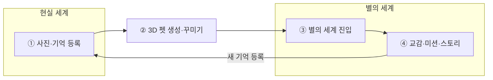
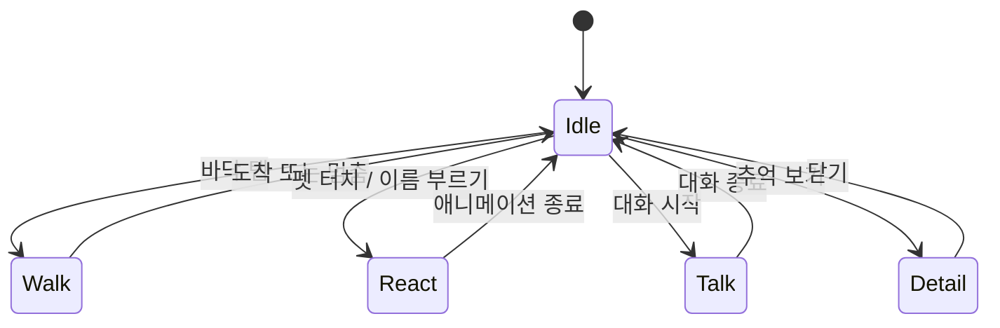
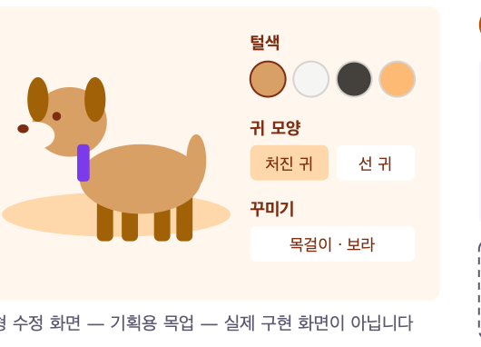
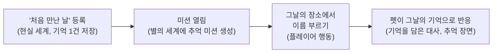

# 02. 게임 디자인

> 상태: 기획·설계 단계 (프로토타입 구현 전)
> 이 문서의 규칙과 수치는 밸런스 초안입니다. 포트폴리오에 정리한 내용은 **기획**, 이 문서에서 처음 구체화한 내용은 **제안**, 테스트로 확인할 내용은 **검증 예정**으로 표시합니다.

## 1. 핵심 플레이 루프 — 기획

| 단계 | 플레이어 행동 | 게임의 반응 | 위치 |
|---|---|---|---|
| ① 사진·기억 등록 | 대표 사진, 성격, 추억을 등록 | 기억을 저장하고, 연결할 수 있는 미션이 있으면 알림 | 현실 세계 |
| ② 3D 펫 생성·꾸미기 | 사진을 닮은 펫을 확인하고 직접 수정 | 사진 특징으로 외형 프리셋을 제안하고, 수정 결과를 저장 | 현실 → 별 |
| ③ 별의 세계 진입 | 별의 세계로 이동 | 펫이 플레이어를 맞이함 (외형·기억·퀘스트 상태 불러오기) | 별의 세계 |
| ④ 교감·미션·스토리 | 대화, 쓰다듬기, 추억 미션 진행 | 기억을 담은 대사, 반응 애니메이션, 추억 장면 | 별의 세계 |

한 번의 방문은 ① 새 기억을 남기거나 ② 이미 남긴 기억으로 펫과 미션을 진행하는 것 중 하나로 끝날 수 있습니다 (**제안**).

## 2. 첫 플레이 경험 — 제안

처음 실행부터 첫 미션 완료까지의 흐름입니다. 예시 펫 이름은 "모카"입니다.

| 순서 | 화면 | 플레이어 행동 | 게임 반응 |
|---|---|---|---|
| 1 | 시작 | 반려동물 이름, 종류(강아지·고양이) 입력 | 관계 상태(함께 사는 중 / 추억 보존)는 선택 입력. 건너뛸 수 있음 |
| 2 | 사진 등록 | 대표 사진 1장 선택 | 배경을 분리하고 털색·귀 모양·무늬 후보를 표시 |
| 3 | 외형 확인 | 제안된 외형을 보고 털색·귀를 직접 고침 | 수정한 외형을 저장 |
| 4 | 성격·기억 | 성격 메모와 "처음 만난 날" 기억 1건 입력 | 기억을 저장하고 첫 만남 미션을 연다 |
| 5 | 별의 세계 | 별의 세계로 이동 | 펫이 맞이하는 첫 대사 ("오늘도 왔구나!") |
| 6 | 첫 미션 | 첫 만남 추억 미션 진행 (4절) | 미션 완료 후 추억 장면 보기 |

**검증 예정:** 첫 미션까지 걸리는 시간과 이탈 단계. 이전 기획서의 임시 기준(첫 기록 저장까지 완료자 중앙값 5분 이내)을 출발점으로 삼고, 첫 측정 뒤 다시 정합니다.

## 3. 펫과의 교감 행동

| 행동 | 플레이어 입력 | 펫·게임 반응 | 표기 |
|---|---|---|---|
| 대화 | 제안 문장 선택 또는 직접 입력 | 성격과 관련 기억을 바탕으로 대사 생성, 근거 기억 표시 | 기획 |
| 쓰다듬기 | 가까운 펫 터치 | 짧은 반응 애니메이션. 재생 중 반복 입력은 한 번만 처리 | 기획 (게임 기획 덱 6쪽) |
| 함께 걷기 | 바닥 탭 | 펫이 지정 지점으로 이동 후 대기 상태로 복귀 | 기획 (게임 기획 덱 6쪽) |
| 이름 부르기 | 이름 부르기 버튼 | 펫이 다가와 반응. 미션 조건이 되기도 함 | 제안 |
| 추억 보기 | 추억 오브젝트 터치 | 연결된 사진과 기억을 연다. 닫으면 같은 위치로 복귀 | 제안 (이전 기획의 "추억별 열람"을 이어받음) |

### 상태 전이 — 제안

- 추억 상세를 여는 동안에는 이동 입력을 잠급니다.
- 반응 애니메이션 중 연속 터치는 무시합니다.
- 대화 응답을 기다리는 동안 펫은 "생각하는" 대기 애니메이션을 재생합니다 (**제안**).

## 4. 캐릭터 꾸미기

| 구분 | 내용 | 표기 |
|---|---|---|
| 외형 수정 | 털색, 귀 모양, 무늬를 미리 보고 저장. 다음 진입에도 같은 외형을 불러옴 | 기획 |
| 꾸미기 아이템 | 목걸이 등 아이템을 색과 함께 적용 | 기획 |
| 아이템 획득 | 추억 미션 완료 보상으로 획득 | 제안 |
| 자동 제안과 직접 수정 구분 | 사진에서 제안된 값과 플레이어가 고친 값을 따로 저장해, 다시 제안받아도 직접 고친 값을 덮어쓰지 않음 | 제안 |

기획용 목업 (포트폴리오 21쪽). 실제 구현 화면이 아닙니다.

외형 개인화의 기술 구조는 [03_CHARACTER_CUSTOMIZATION.md](03_CHARACTER_CUSTOMIZATION.md)에 있습니다.

## 5. 추억 기반 미션과 스토리

### 미션이 만들어지는 규칙 — 제안

- 미션은 **미리 만든 템플릿**에 플레이어의 기억을 끼워 넣어 만듭니다. LLM이 미션의 조건이나 단계를 새로 만들지 않습니다.
- 기억 1건은 미션 템플릿 1개와 연결됩니다 (POC 3 범위).
- 기억의 종류(첫 만남, 산책, 생일 등)에 따라 템플릿과 장소가 정해집니다.
- 미션의 진행 조건, 완료 판정, 보상은 Unity 게임 로직이 결정합니다. LLM은 대사만 만듭니다.

### 예시: 첫 만남의 추억 — 기획 (단계 구성은 제안)

포트폴리오에 정리한 흐름:

POC 3에서 쓸 퀘스트 3단계 (**제안**):

| 단계 | 조건 (게임 로직) | 플레이어 행동 | 게임 반응 |
|---|---|---|---|
| 1. 장소 찾기 | 미션 시작 | 별의 세계에서 표시된 장소로 이동 | 기억에 적힌 장소를 본뜬 장면 오브젝트가 나타남 |
| 2. 이름 부르기 | 플레이어가 장소 안에 있음 | 이름 부르기 | 펫이 달려와 첫 만남 기억을 바탕으로 대사 (LLM) |
| 3. 추억 장면 | 2단계 대사가 끝남 (실패 시 기본 대사로 대체) | 대화 선택지 하나 고르기 | 추억 장면 카드 표시, 미션 완료, 보상 지급 |

예시 대사: "그날 처음 내 이름을 불러 줬지? 조금 무서웠는데 손이 따뜻했어." — 플레이어가 기억에 "겁이 많아 처음엔 숨었다"고 적었을 때를 가정한 가상의 예입니다. 기억에 없는 내용(예: 날씨, 장소 이름)은 넣지 않는 것이 원칙입니다.

## 6. 보상 구조 — 제안

돌봄 수치나 재화 경쟁을 만들지 않고, 보상은 "기억이 쌓인 흔적"으로 둡니다.

| 플레이어 행동 | 게임 반응 | 보상 |
|---|---|---|
| 새 기억 등록 | 연결 가능한 미션이 열림 | 새 미션 |
| 추억 미션 완료 | 추억 장면 카드 생성 | 추억 장면 카드 (현실 세계 타임라인에서도 열람) |
| 미션 완료 누적 | 별의 세계에 장소가 하나씩 늘어남 | 새 장소 (예: 기억 3건마다 1곳 — 이전 기획의 "기록 3개 → 배치 위치 1곳 추가" 안을 이어받은 초안) |
| 특정 기억 종류의 미션 완료 | 그 기억과 어울리는 꾸미기 아이템 | 꾸미기 아이템 |
| 대화, 쓰다듬기 | 반응과 대사 | 별도 보상 없음 (교감 자체가 목적) |

**검증 예정:** 보상이 기억 등록을 늘리는지, 아니면 의무감을 만드는지. 기억 등록을 보상으로 압박하지 않는 것이 원칙입니다.

## 7. 반복 플레이 동기

| 동기 | 설계 | 표기 |
|---|---|---|
| 새 이야기를 보고 싶음 | 새 기억을 등록하면 새 미션과 대사가 생김 | 기획 |
| 펫을 더 닮게 만들고 싶음 | 외형 수정과 아이템 꾸미기 | 기획 |
| 지난 추억을 다시 보고 싶음 | 타임라인과 별의 세계 양쪽에서 추억 장면을 다시 엶 | 제안 |
| 펫이 나를 기억함 | 대화에서 이전에 등록한 기억을 꺼냄 | 기획 |

## 8. 게임 종료와 재방문 구조

- **미접속 불이익 없음.** 펫의 상태가 나빠지거나 돌봄에 실패하는 상태를 두지 않습니다 (기획).
- **한 번의 방문은 짧게 끝날 수 있습니다.** 미션 하나나 대화 몇 번으로 마무리되는 단위를 기본으로 합니다 (제안).
- **이어하기.** 미션 단계를 완료할 때마다 진행을 저장하고, 중단 후 다시 실행하면 마지막 저장 단계부터 이어갑니다 (기획).
- **엔딩.** 수명·이별이 있는 스토리를 기본으로 두지 않습니다. 엔딩이 있는 스토리와 엔딩 없는 상설 공간을 플레이어가 고르는 안이 이전 기획서에 있으며, 현재는 범위 밖입니다 (검증 예정).
- **재방문 알림.** 새 미션이 열렸을 때만 알리는 안을 검토합니다. 감정을 자극해 접속을 유도하는 알림은 쓰지 않습니다 (제안).

## 9. 검증할 질문

| 질문 | 방법 |
|---|---|
| 첫 미션까지 이탈 없이 도달하는가 | 첫 플레이 단계별 이탈 기록 |
| 추억 미션이 다시 방문할 이유가 되는가 | 7일 안에 자발적으로 다시 열었는지와 이유 인터뷰 |
| 보상이 의무감을 만드는가 | 플레이 후 인터뷰 |
| 대사가 "내 반려동물 같다"고 느껴지는가 | 대사 평정 (5점 척도) |
