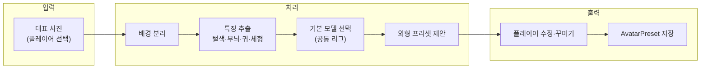
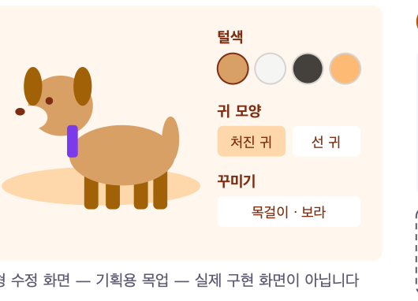
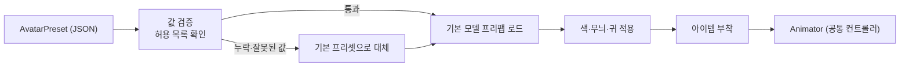

# 03. 핵심 콘셉트 ① 생성형 비전 기반 3D 펫 커스터마이징

> 상태: 기술 설계안 (구현 전). 이 문서의 기술은 모두 **후보**이며 실제로 사용하거나 검증한 기술이 아닙니다.

## 1. 목표

플레이어가 고른 대표 사진에서 털색, 무늬, 귀 모양, 체형 같은 특징을 뽑아 **내 반려동물을 닮은 3D 펫**을 만들고, 플레이어가 직접 고치고 꾸밀 수 있게 합니다.

성공 기준은 원본 사진을 픽셀 단위로 재현하는 것이 아닙니다. **게임 안에서 보기 좋으면서 "내 반려동물 같다"고 느끼는 것**이 목표입니다.

## 2. 기본안: 사진 특징으로 기본 모델 개인화

매번 메시를 새로 생성하지 않습니다. 사진의 특징으로 기본 모델을 개인화한 뒤 플레이어가 직접 고치는 방식을 기본안으로 둡니다.



<sub>기술 다이어그램 (설계안)</sub>

### 2.1 대표 사진 입력

| 항목 | 설계 |
|---|---|
| 입력 | 플레이어가 고른 사진 1장 (POC 1 범위) |
| 권장 조건 | 반려동물 한 마리, 몸 전체 또는 상반신, 얼굴이 정면이나 측면으로 보이는 사진 |
| 사진 안내 | 업로드 전에 "어떤 사진이 잘 되는지" 예시를 보여줌 (**제안**) |
| 개인정보 | 원본 EXIF와 위치 정보는 처리 전에 제거. 서버 처리 시 동의를 받음 (이전 기획서 원칙) |

### 2.2 배경 분리와 외형 특징 추출

| 단계 | 하는 일 | 기술 후보 |
|---|---|---|
| 배경 분리 | 반려동물 영역만 남김 | Segment Anything (SAM / SAM 2) 등 분할 모델 |
| 종·체형 분류 | 강아지/고양이, 소형·중형·대형, 다리 길이 | 이미지 분류 모델 또는 비전 LLM |
| 털색 | 주 색상과 보조 색상 | 분리된 영역의 색상 군집화 |
| 무늬 | 단색, 얼룩, 얼굴 마스크 등 | 비전 LLM에 허용 목록 중 하나를 고르게 함 |
| 귀 모양 | 선 귀, 처진 귀, 반쯤 접힌 귀 | 비전 LLM에 허용 목록 중 하나를 고르게 함 |

특징 추출 모델이 자유 텍스트를 내놓지 않도록, 결과는 **허용 목록 안의 값**만 받습니다 (**제안**).

### 2.3 특징 데이터 — 제안

```json
{
  "species": "dog",
  "bodyType": "small_shortleg",
  "furColor": { "primary": "#D9A066", "secondary": "#F5F5F4" },
  "pattern": "face_mask",
  "earShape": "floppy",
  "confidence": { "bodyType": 0.82, "pattern": 0.61, "earShape": 0.90 },
  "source": "auto"
}
```

- `source`는 자동 제안(`auto`)인지 플레이어 수정(`user`)인지 구분합니다. 다시 제안받아도 플레이어가 고친 값은 덮어쓰지 않습니다.
- 신뢰도가 낮은 항목은 화면에서 "직접 확인해 주세요"로 표시합니다.

### 2.4 강아지·고양이 기본 모델과 공통 리그

| 항목 | 설계 |
|---|---|
| 기본 모델 | POC 1은 강아지 1종(또는 체형 2종)부터. 고양이는 그다음 단계 |
| 리그 | 종별로 공통 리그 1종을 고정. 체형 차이는 블렌드셰이프나 본 길이 조정으로 표현 |
| 동작 | 대기·걷기·쓰다듬기 반응을 공통 리그에서 재사용 |
| Unity 설정 | 네 발 동물이므로 Humanoid가 아닌 **Generic** 리그로 가져옴 (Unity 문서 기준. Humanoid는 두 다리, 두 팔, 머리 구조를 전제) |

### 2.5 특징을 반영한 외형 개인화

| 특징 | 반영 방법 (제안) |
|---|---|
| 털색 | 머티리얼 색상 파라미터 |
| 무늬 | 무늬 마스크 텍스처 교체 |
| 귀 모양 | 귀 메시 교체 또는 블렌드셰이프 |
| 체형 | 기본 모델 선택 + 본 길이 조정 |

### 2.6 사용자의 직접 수정과 꾸미기

- 털색, 귀 모양, 무늬를 미리 보고 고친 뒤 저장합니다.
- 목걸이 같은 꾸미기 아이템을 붙입니다. 아이템은 리그의 고정 부착 지점(목, 머리)에 연결합니다 (**제안**).



<sub>기획용 목업 (포트폴리오 PDF 4쪽). 실제 구현 화면이 아닙니다.</sub>

### 2.7 Unity 캐릭터 적용 구조 — 제안



- 외형 값은 허용 목록으로 검증하고, 누락된 값은 기본 프리셋으로 복원합니다 (기획).
- JSON 파싱은 Unity `JsonUtility` 또는 Newtonsoft Json 패키지를 후보로 둡니다.

## 3. 이미지 기반 3D 생성 방식과의 비교

| 기준 | A. 이미지 기반 3D 생성 | B. 기본 모델 개인화 (기본안) | C. 하이브리드 |
|---|---|---|---|
| 방식 | 사진에서 메시와 텍스처를 직접 생성 | 기본 모델에 특징 프리셋 적용 | 기본 모델 + 생성 텍스처나 일부 부위만 생성 |
| 닮음 | 높을 수 있음 | 표현 한계 있음 | 중간 |
| 품질 안정성 | 사진마다 달라짐 | 안정적 | 중간 |
| 리깅·애니메이션 | 결과마다 리깅 필요, 실패 가능 | 공통 리그로 재사용 | 대부분 재사용 |
| 비용·시간 | 생성마다 API 비용·대기 | 낮음 | 중간 |
| 모바일 성능 | 폴리곤·텍스처 크기 관리 필요 | 예측 가능 | 예측 가능 |

기본안은 B입니다. A는 같은 사진으로 비교 실험을 한 뒤, 만족도가 낮을 때만 범위를 넓힙니다.

## 4. 기술 후보

| 후보 | 용도 | 확인한 내용 (공식 자료 기준) | 비고 |
|---|---|---|---|
| [Unique3D](https://github.com/AiuniAI/Unique3D) | 이미지 한 장 → 텍스처 메시 (A 비교용) | 논문 arXiv:2405.20343. 저장소에 MIT 라이선스 표시 | 모델 가중치와 기반 모델의 라이선스는 별도 확인 필요 |
| [Tripo (Tripo3D)](https://developers.tripo3d.ai/) | 이미지 → 3D, 자동 리깅 (A 비교용) | API 문서에 자동 리깅과 네 발 동물(quadruped) 리그 유형이 있음 | 상용 API. 비용·품질 직접 확인 전 |
| [Segment Anything (SAM 2)](https://github.com/facebookresearch/sam2) | 배경 분리 | 코드·체크포인트 Apache 2.0 | |
| [SMAL](https://smal.is.tue.mpg.de/) | 네 발 동물 형상 모델 (연구 참고) | 비상업 연구용 라이선스 | 제품에 직접 쓰지 않음 |
| 비전 LLM | 무늬·귀 모양 분류 | — | 허용 목록 응답만 사용 |

위 후보 중 실제로 사용해 본 것은 없습니다. 출처는 [07_REFERENCES.md](07_REFERENCES.md)에 있습니다.

## 5. 리깅·애니메이션 재사용의 기술적 위험

| 위험 | 설명 | 대응 (제안) |
|---|---|---|
| 사람용 골격 재사용 불가 | 이전 프로젝트에서 쓴 SMPL은 사람 모델이라 네 발 동물에 쓸 수 없음 | 종별 공통 리그를 직접 고정 |
| 생성 메시의 리깅 실패 | 이미지 기반 생성 결과는 다리·꼬리가 붙거나 형태가 불완전할 수 있음 | 생성 결과는 비교 실험에만 사용. 자동 리깅 결과는 리그 검사 후 채택 |
| 체형 변형 시 애니메이션 깨짐 | 본 길이를 바꾸면 발이 바닥을 뚫거나 뜰 수 있음 | 체형 범위 제한, 발 위치 보정(IK) 검토 |
| 귀·꼬리 교체 시 웨이트 불일치 | 교체한 부위가 리그와 맞지 않음 | 교체 부위도 같은 본에 웨이트를 미리 맞춰 둠 |
| 아이템 관통 | 체형마다 목걸이 위치가 다름 | 부착 지점 본 기준으로 배치, 체형별 오프셋 |
| 상업적 라이선스 | SMAL 등 연구용 모델은 상업 이용 금지 | 연구 참고로만 사용 |

## 6. 최소 구현 범위 (POC 1)

- 강아지 기본 모델 1종 + 공통 리그
- 사진 1장에서 털색·귀 모양·무늬 추출 → 프리셋 제안
- 플레이어 수정·저장, 대기·걷기 동작
- 같은 사진으로 기본형과 개인화형 비교 화면

## 7. 성공 기준

| 기준 | 측정 |
|---|---|
| 저장한 외형이 그대로 복원된다 | 저장 → 앱 재실행 → 같은 값으로 로드 |
| 개인화형이 기본형보다 더 닮았다 | 같은 사진으로 기본형·개인화형을 5점 척도로 비교 |
| 특징 추출이 쓸 만하다 | 자동 제안 값 중 플레이어가 고치지 않고 유지한 비율 |
| 모바일에서 동작한다 | 펫 표시 화면의 FPS, 메모리 |

수치 목표는 첫 측정 뒤에 정합니다. 자세한 계획은 [06_PROTOTYPE_PLAN.md](06_PROTOTYPE_PLAN.md#poc-1-사진-기반-3d-펫-개인화)에 있습니다.
