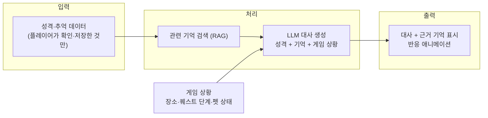
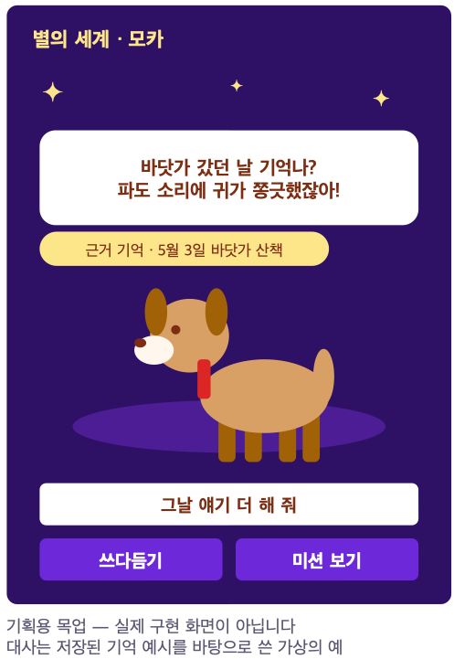
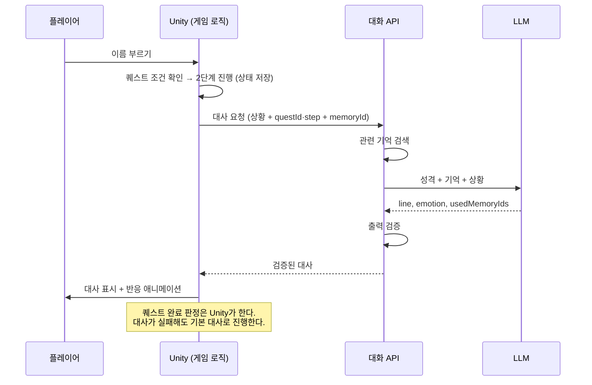

# 04. 핵심 콘셉트 ② 기억 기반 AI 펫과의 교감

> 상태: 기술 설계안 (구현 전). 이 문서의 기술은 모두 **후보**이며 실제로 사용하거나 검증한 기술이 아닙니다.

## 1. 목표

펫이 플레이어가 저장한 성격과 추억을 기억하고, 별의 세계에서 대화·미션·스토리로 이어지게 합니다.

두 가지 원칙을 지킵니다.

1. **펫은 플레이어가 저장한 성격과 추억만을 근거로 말합니다.** 기억에 없는 사실은 지어내지 않습니다.
2. **게임 진행은 게임 로직이, 대사 표현은 LLM이 맡습니다.** LLM 출력은 퀘스트 상태를 바꾸지 못합니다.

## 2. 처리 흐름



<sub>기술 다이어그램 (설계안)</sub>



<sub>기획용 목업 (포트폴리오 PDF 5쪽). 실제 구현 화면이 아니며, 대사는 저장된 기억 예시를 바탕으로 쓴 가상의 예입니다.</sub>

## 3. 펫 성격과 기억 데이터 정의

### 3.1 성격 (PetProfile) — 제안

| 필드 | 예시 | 용도 |
|---|---|---|
| `name` | 모카 | 대사 속 호칭 |
| `traits` | ["겁이 많음", "호기심이 많음"] | 말투와 반응 |
| `likes` / `dislikes` | 바닷가 산책 / 청소기 소리 | 대화 소재 |
| `nicknames` | 모카, 콩이 | 플레이어가 부르던 별명 |
| `speechStyle` | 반말, 짧은 문장 | 대사 톤 |

성격은 플레이어가 직접 입력합니다. LLM이 성격을 추측해서 채우지 않습니다.

### 3.2 기억 (Memory) — 기획 + 제안

| 필드 | 설명 | 표기 |
|---|---|---|
| `memoryId` | 유일 ID. 편집해도 유지 | 기획 |
| `petId` | 어느 펫의 기억인지 | 기획 |
| `photoIds` | 연결된 사진 | 기획 |
| `body` | 플레이어가 쓴 본문 | 기획 |
| `status` | 임시 저장 / 저장됨 / 삭제됨 | 기획 |
| `kind` | 첫 만남, 산책, 생일 등. 미션 템플릿 선택에 사용 | 제안 |
| `date`, `place` | 플레이어가 입력한 날짜·장소 (선택) | 제안 |
| `facts` | 대화에 써도 되는 짧은 사실 목록. 플레이어가 확인 | 제안 |
| `allowInChat` | 이 기억을 대화에 써도 되는지 | 제안 |

## 4. 사진·일기·기억의 저장 구조 — 제안

| 데이터 | 저장 위치 | 검색용 인덱스 |
|---|---|---|
| 사진 원본 | 기기 로컬 파일 | 없음 |
| 사진 메타데이터 (PhotoAsset) | 로컬 DB | 없음 |
| 기억 본문 (Memory) | 로컬 DB (원본) | 벡터 인덱스에 `facts`와 요약을 임베딩 |
| 성격 (PetProfile) | 로컬 DB | 없음 (매 요청에 그대로 포함) |

- 원본은 DB에 두고, 벡터 인덱스는 **검색용 사본**으로만 씁니다. 인덱스가 손상되면 DB에서 다시 만듭니다.
- `status = 저장됨`이고 `allowInChat = true`인 기억만 인덱스에 넣습니다.

## 5. RAG 기반 관련 기억 검색

1. 대화 요청이 오면 **검색 질의**를 만듭니다: 플레이어 발화 + 현재 장소 + 퀘스트에 연결된 `memoryId`.
2. 퀘스트에 연결된 기억이 있으면 그 기억은 **검색과 상관없이 항상 포함**합니다.
3. 나머지는 벡터 검색으로 상위 몇 개를 가져옵니다 (개수는 POC 2에서 정함).
4. 유사도가 기준보다 낮으면 기억을 넣지 않고, "모르는 것"으로 처리합니다.

## 6. LLM 대화 생성

LLM에 넘기는 입력 (**제안**):

```text
[역할] 너는 플레이어의 반려동물 '모카'를 표현하는 게임 캐릭터다. 실제 반려동물이 아니다.
[성격] 겁이 많음, 호기심이 많음. 반말, 짧은 문장.
[게임 상황] 장소: 별의 바닷가 / 퀘스트: first_meeting 2단계 / 펫 상태: Idle
[사용 가능한 기억] (m_012) 처음 만난 날, 겁이 많아 소파 밑에 숨었다.
[규칙] 위 기억에 없는 사실(날짜, 장소, 사람, 사건)을 만들지 않는다.
       모르면 "그건 잘 기억이 안 나"처럼 말하고 플레이어에게 물어본다.
       퀘스트 진행, 보상, 아이템을 언급하거나 약속하지 않는다.
```

LLM 출력 형식 (**제안**):

```json
{
  "line": "처음 만났을 때 나 소파 밑에 숨었었지? 그래도 계속 기다려 줬잖아.",
  "emotion": "happy",
  "usedMemoryIds": ["m_012"]
}
```

- `emotion`은 허용 목록(기쁨, 신남, 수줍음, 졸림 등) 안에서만 받고, Unity가 반응 애니메이션으로 바꿉니다.
- `usedMemoryIds`는 화면에 "근거 기억"으로 표시합니다.

## 7. 현재 게임 상황과 퀘스트 상태 반영

| 게임 상황 | LLM에 주는 정보 | LLM이 할 수 없는 것 |
|---|---|---|
| 장소 | 장소 이름 | 장소 이동 |
| 퀘스트 단계 | 퀘스트 ID, 단계 번호, 단계 설명 | 단계 완료, 보상 지급 |
| 펫 상태 | Idle, Walk 등 | 애니메이션 직접 지정 (감정 값만 제안) |

## 8. Unity 게임 상태 관리와 LLM 대사 생성의 역할 분리



| 담당 | 결정하는 것 |
|---|---|
| Unity 상태 기계 | 진행 조건, 완료 판정, 보상, 저장 |
| LLM | 대사 문장, 감정 값 제안 |

이렇게 나눈 이유는 [08_DECISIONS.md](08_DECISIONS.md)에 있습니다.

## 9. 기억에 없는 사실 생성 방지

| 단계 | 방법 |
|---|---|
| 입력 | 플레이어가 확인·저장한 기억만 넣음. 사진에서 추측한 감정은 넣지 않음 |
| 지시 | 기억에 없는 날짜·장소·사람·사건을 만들지 않도록 규칙을 명시 |
| 출력 검증 | `usedMemoryIds`가 실제로 넘긴 기억인지 확인. 날짜·숫자·고유명사가 기억에 없으면 다시 생성하거나 기본 대사로 대체 (**제안**) |
| 평가 | 평가용 질문 세트로 답변의 근거 기억을 확인 (기획). 기억에 없는 내용을 묻는 질문을 일부러 포함 |

이전 기획서의 원칙도 그대로 둡니다. 사진 속 바닷가 장면만 보고 "주인이 공을 던져줘서 행복했다"고 지어내지 않고, 감정과 의미는 플레이어가 추가합니다.

## 10. 응답 지연·실패 대응 — 제안

| 상황 | 처리 |
|---|---|
| 응답 대기 | 펫의 "생각하는" 애니메이션을 재생. 입력은 막지 않음 |
| 시간 초과 (예: 5초, 측정 후 조정) | 미리 준비한 기본 대사로 진행 |
| API 오류 | 기본 대사로 진행, 재시도 버튼 없이 다음 대화에서 다시 시도 |
| 검증 실패 | 1회 재생성, 다시 실패하면 기본 대사 |
| 중복 응답 | 요청 ID가 현재 대화와 다르면 버림 |

기본 대사는 퀘스트 단계마다 미리 작성해 둡니다. **LLM이 모두 실패해도 미션을 끝낼 수 있어야 합니다.**

## 11. 개인정보 보호와 기록 삭제

| 항목 | 설계 |
|---|---|
| 전송 동의 | 기억을 대화 API로 보내기 전 동의. 미동의 시 기본 대사만 사용 |
| 최소 전송 | 검색된 기억의 `facts`만 전송. 사진 원본과 위치 정보는 보내지 않음 |
| 기억별 제외 | `allowInChat = false`로 특정 기억을 대화에서 제외 |
| 삭제 | 기억 삭제 시 DB, 벡터 인덱스, 연결된 퀘스트 진행을 함께 정리 (05 문서 참고) |
| 대화 기록 | 대화 로그 저장 여부를 설정에서 선택, 전체 삭제 가능 |
| 가상 표현 | AI 대화가 실제 반려동물의 말이나 의식이 아님을 처음 사용할 때 안내 |
| 외부 API | LLM API의 데이터 보관·학습 정책을 확인한 뒤 채택 |

## 12. 기술 후보

| 후보 | 용도 | 비고 |
|---|---|---|
| [LangChain](https://docs.langchain.com/oss/python/langchain/retrieval) | 검색·프롬프트 구성 | 직접 구현과 비교 후 결정 |
| [Chroma (ChromaDB)](https://docs.trychroma.com/) | 벡터 인덱스 | Apache 2.0. 로컬 실행 가능 |
| LLM API | 대사 생성 | 응답 시간, 비용, 데이터 정책으로 비교 |
| Python 백엔드 (FastAPI 등) | 대화 API | 이전 기획서의 후보 |
| Unity `UnityWebRequest` | Unity → 대화 API 호출 | |

위 후보 중 실제로 사용해 본 것은 없습니다.

## 13. 최소 구현 범위 (POC 2)

- 펫 1마리의 성격과 기억 5~10건 저장
- 관련 기억을 검색해 텍스트로 대화 (Unity 없이 먼저 검증)
- 답변마다 근거 기억 표시
- 평가용 질문 세트와 결과 기록

## 14. 검증 기준

| 기준 | 측정 |
|---|---|
| 답변이 저장된 기억에 근거한다 | 평가용 질문 세트에서 근거 기억이 맞는 답변의 비율 |
| 없는 사실을 지어내지 않는다 | 기억에 없는 내용을 묻는 질문에서 지어낸 답변 수 |
| 성격이 드러난다 | 플레이어 5점 평정 |
| 응답 시간이 견딜 만하다 | 응답 시간 분포, 시간 초과 비율 |

수치 목표는 첫 측정 뒤에 정합니다. 자세한 계획은 [06_PROTOTYPE_PLAN.md](06_PROTOTYPE_PLAN.md#poc-2-기억-기반-ai-대화)에 있습니다.
