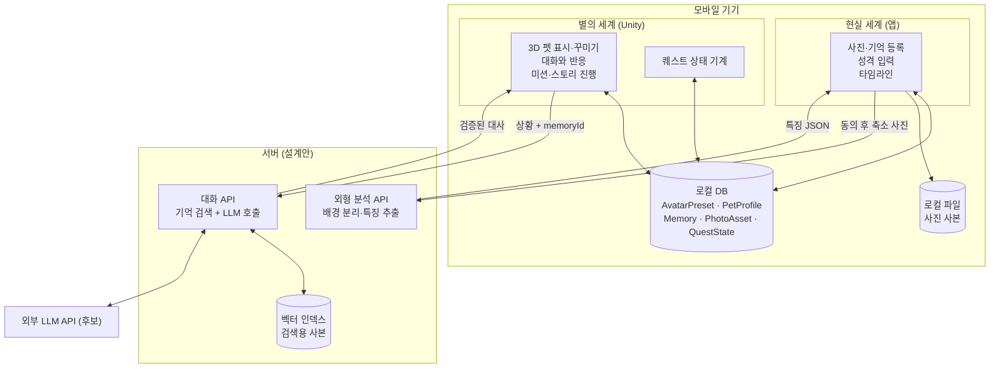
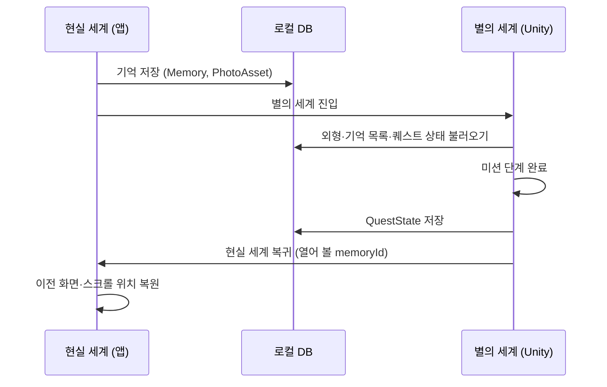
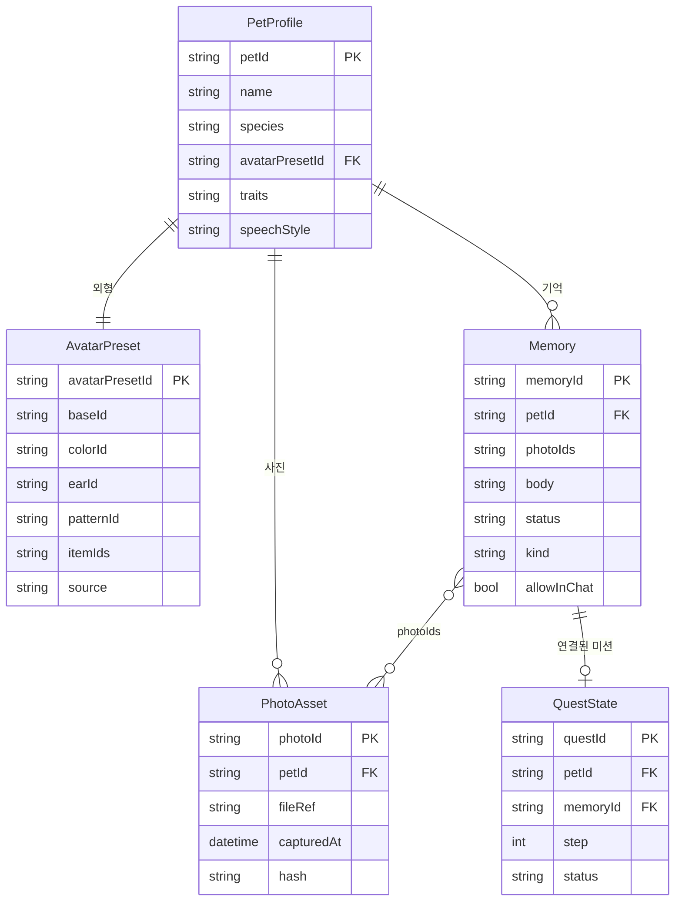
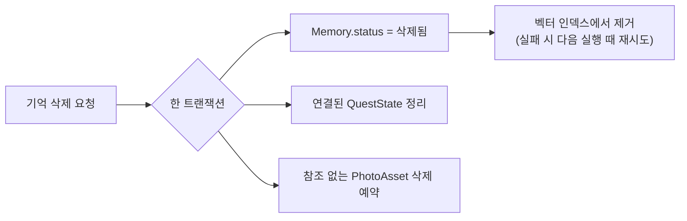
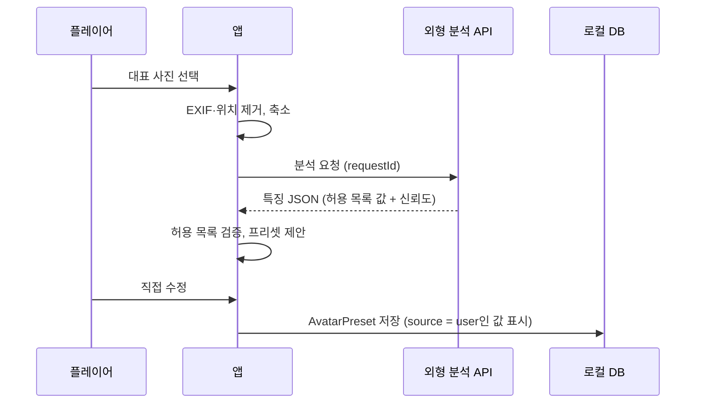

# 05. 시스템 아키텍처

> **이 문서는 설계안입니다. 실제로 구현한 시스템이 아닙니다.**
> [포트폴리오 PDF](../portfolio/Eternal_Pet_Portfolio.pdf) 6쪽에 정리한 구조(**기획**)를 바탕으로, 필드와 흐름을 더 구체화한 부분은 **제안**으로 표시합니다.

## 1. 전체 시스템 구성도

기술 다이어그램 (설계안)

| 구성 요소 | 역할 | 상태 |
|---|---|---|
| 현실 세계 (앱) | 기억·사진·성격의 생성·수정·삭제 | 설계안 |
| 별의 세계 (Unity) | 3D 펫 표시, 교감, 미션 진행. 퀘스트 진행만 기록 | 설계안 |
| 로컬 DB | 두 세계가 함께 보는 원본 데이터 | 설계안 |
| 외형 분석 API | 사진 → 특징 JSON | 설계안 |
| 대화 API | 기억 검색, LLM 호출, 출력 검증 | 설계안 |

앱과 Unity를 하나의 앱으로 합칠지(Unity as a Library), Unity 단독 앱으로 시작할지는 정하지 않았습니다. Unity 문서 기준으로 Unity as a Library는 모바일에서 전체 화면으로만 표시되고 한 번에 하나의 Unity 런타임만 쓸 수 있어, POC 단계에서는 **Unity 단독 앱 안에 현실 세계 화면을 함께 만드는 안**을 먼저 검토합니다 (**제안**).

## 2. 현실 세계 앱과 Unity 게임 간 데이터 흐름

| 방향 | 전달하는 것 | 표기 |
|---|---|---|
| 앱 → Unity | 외형 프리셋, 기억 목록(`memoryId`, 제목, 종류) | 기획 |
| Unity → 앱 | 사용자가 연 `memoryId` (상세 열람·삭제는 앱이 처리) | 기획 |
| Unity → DB | 퀘스트 진행 (`QuestState`) | 기획 |

## 3. 데이터 모델

| 모델 | 필드 (기획) | 추가 필드 (제안) | 담는 것 |
|---|---|---|---|
| **AvatarPreset** | `baseId`, `colorId`, `earId`, `patternId`, 꾸미기 아이템 | `avatarPresetId`, `source`(auto/user), `version` | 펫 외형 |
| **PetProfile** | `petId`, `name`, `avatarPresetId`, 성격 메모 | `species`, `traits`, `speechStyle` | 펫 기본 정보와 성격 |
| **Memory** | `memoryId`, `petId`, `photoIds`, `body`, `status` | `kind`, `date`, `place`, `facts`, `allowInChat`, `updatedAt` | 플레이어가 남긴 기억 |
| **PhotoAsset** | `photoId`, `fileRef`, `capturedAt?`, `hash` | `petId`, `isRepresentative` | 기억에 연결된 사진의 로컬 사본 |
| **QuestState** | `questId`, `step`, `status`, `memoryId` | `petId`, `templateId`, `updatedAt` | 미션 진행 |

## 4. ID와 연결 규칙

| 규칙 | 표기 |
|---|---|
| 모든 데이터는 `petId`에 속한다 | 기획 |
| `memoryId`는 유일하고, 편집해도 바뀌지 않는다 | 기획 |
| 저장된(`status = 저장됨`) 기억만 별의 세계에 노출한다 | 기획 |
| 외형 값은 허용 목록으로 검증하고, 누락 값은 기본 프리셋으로 복원한다 | 기획 |
| `PhotoAsset`은 어떤 기억도 참조하지 않을 때 삭제한다 | 기획 (게임 기획 덱 12쪽) |
| 기억 1건은 최대 1개의 진행 중 `QuestState`와 연결된다 (POC 3 범위) | 제안 |
| ID는 기기에서 생성하는 UUID를 쓴다 | 제안 |

## 5. 저장·수정·삭제·복구 흐름

| 동작 | 처리 | 표기 |
|---|---|---|
| 저장 | 기억과 사진 연결을 **한 트랜잭션**으로 저장 | 기획 |
| 수정 | 같은 `memoryId`로 본문 갱신. 대화 인덱스는 다시 만듦 | 기획 + 제안 |
| 삭제 | 기억, 인덱스 항목, 연결된 퀘스트 진행을 함께 정리 | 기획 (추가 설계안) |
| 복구 | 삭제 직후 일정 시간 동안 "되돌리기" 제공 후 영구 삭제 | 제안 |
| 재실행 | 마지막으로 저장한 미션 단계부터 이어감 | 기획 |

벡터 인덱스는 검색용 사본이므로 DB와 어긋나면 DB를 기준으로 다시 만듭니다 (**제안**).

## 6. 외형 생성 요청과 결과 저장 — 제안

- 분석에 실패하면 기본 프리셋을 보여주고 직접 고르게 합니다.
- 같은 `requestId`의 늦은 응답은 무시하고, 플레이어가 고친 값을 덮어쓰지 않습니다.

## 7. AI 대화 요청·응답 흐름 — 제안

[04_AI_PET_INTERACTION.md](04_AI_PET_INTERACTION.md#8-unity-게임-상태-관리와-llm-대사-생성의-역할-분리)의 순서도를 따릅니다. 요약:

1. Unity가 퀘스트 상태를 먼저 갱신하고 저장합니다.
2. Unity가 대화 API에 상황, `questId`·`step`, 연결된 `memoryId`를 보냅니다.
3. 대화 API가 기억을 검색하고 LLM을 호출한 뒤 출력을 검증합니다.
4. Unity는 검증된 대사를 표시합니다. 실패하면 기본 대사를 표시합니다.

## 8. 오류 발생 시 복구 방식

| 오류 | 복구 | 표기 |
|---|---|---|
| 사진 일부 읽기 실패 | 실패 건수를 보여주고 정상 사진으로 계속 진행 | 기획 (게임 기획 덱 15쪽) |
| 외형 분석 실패 | 기본 프리셋 + 직접 선택 | 제안 |
| 대화 API 실패·시간 초과 | 기본 대사로 진행. 미션은 끝까지 진행 가능 | 기획 |
| 저장 버튼 연속 입력 | 같은 기억이 1건만 저장됨 | 기획 (게임 기획 덱 15쪽) |
| 미션 중 앱 종료 | 마지막 저장 단계부터 이어하기 | 기획 |
| AvatarPreset 손상·누락 | 허용 목록 검증 후 기본 프리셋으로 복원 | 기획 |
| 벡터 인덱스와 DB 불일치 | DB 기준으로 인덱스 재생성 | 제안 |
| 전송 미동의 | 네트워크 전송 없이 기록·외형 직접 수정·기본 대사로 플레이 | 기획 + 제안 |
