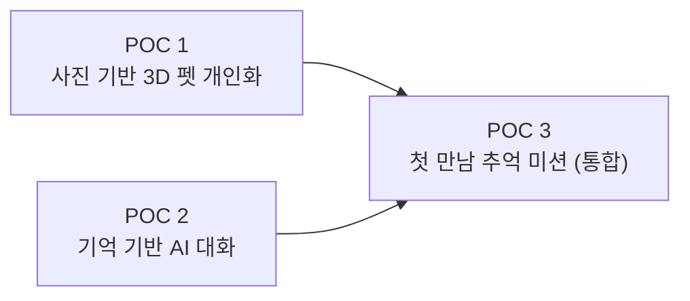

# 06. 프로토타입 계획

> **현재 상태: 세 POC 모두 구현 전입니다.**
> 수치 목표는 첫 측정 뒤에 정합니다. 아래 기술은 모두 **후보**입니다.

## 진행 순서

POC 1과 2는 서로 의존하지 않으므로 따로 검증합니다. 두 POC의 결과를 POC 3에서 하나의 미션으로 연결합니다. 이렇게 나눈 이유는 [08_DECISIONS.md](08_DECISIONS.md)에 있습니다.

| POC | 상태 | 핵심 질문 |
|---|---|---|
| POC 1 | 구현 전 | 사진 특징으로 개인화한 펫이 기본형보다 더 닮았다고 느끼는가 |
| POC 2 | 구현 전 | 답변이 저장된 기억에 근거하고 없는 사실을 지어내지 않는가 |
| POC 3 | 구현 전 | 기억 등록부터 미션 완료까지 끊김 없이 진행되는가 |

---

## POC 1. 사진 기반 3D 펫 개인화

**상태: 구현 전** · 상세 설계: [03_CHARACTER_CUSTOMIZATION.md](03_CHARACTER_CUSTOMIZATION.md)

| 항목 | 내용 |
|---|---|
| 검증할 가설 | 기본 모델에 사진 특징(털색·귀·무늬)만 반영해도 플레이어는 기본형보다 "내 반려동물 같다"고 느낀다 |
| 최소 구현 범위 | 강아지 기본 모델 1종 + 공통 리그 / 사진에서 털색·귀·무늬 추출 → 프리셋 제안 / 플레이어 수정·저장 / 대기·걷기 동작 |
| 입력 | 반려동물 사진 1장 |
| 출력 | 특징 JSON, AvatarPreset, Unity 씬의 개인화된 펫 |
| 기술 후보 | SAM 2 (배경 분리), 비전 LLM 또는 분류 모델 (특징 분류), Unity (Generic 리그, Animator), 비교용 Unique3D · Tripo |

### 구현 순서

1. 강아지 기본 모델 1종에 Generic 리그와 대기·걷기 애니메이션을 고정
2. 털색·귀·무늬를 바꾸는 외형 파라미터와 허용 목록 정의
3. 수동 프리셋 편집과 저장·복원 (사진 없이)
4. 사진 → 배경 분리 → 특징 JSON 추출 스크립트
5. 특징 JSON → 프리셋 제안 연결
6. 같은 사진으로 기본형·개인화형 비교 화면
7. (비교 실험) 같은 사진으로 이미지 기반 3D 생성 결과를 함께 비교

### 성공 기준

- 저장한 외형이 앱 재실행 후 그대로 복원된다.
- 같은 사진으로 비교했을 때 개인화형이 기본형보다 닮음 점수(5점 척도)가 높다.
- 자동 제안 값 중 플레이어가 고치지 않고 유지한 비율을 기록한다 (목표값은 첫 측정 뒤 결정).

### 실패 시 대안

| 실패 상황 | 대안 |
|---|---|
| 개인화 효과가 작음 | 기본 모델을 늘리기 전에 귀·무늬 표현을 먼저 보강 |
| 특징 추출이 자주 틀림 | 자동 제안 항목을 줄이고 직접 선택 UI를 강화 |
| 프리셋으로 닮음 표현이 부족 | 하이브리드(생성 텍스처) 또는 이미지 기반 3D 생성 비교 범위 확대 |

### 예상 기술적 위험

특징 추출 오류, 프리셋의 표현 한계, 체형 변형 시 애니메이션 깨짐, 모바일 성능.

---

## POC 2. 기억 기반 AI 대화

**상태: 구현 전** · 상세 설계: [04_AI_PET_INTERACTION.md](04_AI_PET_INTERACTION.md)

| 항목 | 내용 |
|---|---|
| 검증할 가설 | 저장한 성격과 기억만 근거로 대사를 만들면, 없는 사실 없이도 "나를 기억하는 펫"처럼 느껴진다 |
| 최소 구현 범위 | 펫 1마리의 성격과 기억 5~10건 / 관련 기억 검색 후 텍스트 대화 / 답변마다 근거 기억 표시 / 평가용 질문 세트 |
| 입력 | PetProfile, Memory 목록, 플레이어 발화, 게임 상황(장소·퀘스트 단계) |
| 출력 | `line`, `emotion`, `usedMemoryIds` |
| 기술 후보 | Chroma (벡터 인덱스), LangChain 또는 직접 구현, LLM API, Python 백엔드 |

### 구현 순서

1. 예시 펫의 성격과 기억 데이터 작성 (실제 개인 데이터 대신 예시 데이터 사용)
2. 평가용 질문 세트 작성 — 기억에 있는 질문, 기억에 없는 질문, 퀘스트 상황 질문
3. 벡터 인덱스 구축과 검색 결과 확인
4. 프롬프트와 출력 형식(JSON) 작성
5. 출력 검증 (근거 기억 ID, 기억에 없는 날짜·고유명사)
6. 질문 세트로 평가하고 결과 기록
7. 시간 초과·실패 시 기본 대사 처리

### 성공 기준

- 답변이 저장된 기억에 근거한다 (평가용 질문 세트로 확인).
- 기억에 없는 내용을 묻는 질문에 사실을 지어내지 않는다.
- 응답 시간 분포와 시간 초과 비율을 기록한다.

### 실패 시 대안

| 실패 상황 | 대안 |
|---|---|
| 없는 사실을 자주 만듦 | 기억 본문 대신 확인된 `facts`만 넘기고, 출력 검증을 강화 |
| 검색이 엉뚱한 기억을 가져옴 | 퀘스트에 연결된 기억을 고정 포함하고 검색 개수를 줄임 |
| 응답이 너무 느림 | 대사를 미리 생성해 두는 방식(미션 시작 시 생성) 검토 |
| 비용이 큼 | 짧은 대사 위주, 캐시, 더 작은 모델 비교 |

### 예상 기술적 위험

기억에 없는 내용 생성, 응답 지연, API 비용, 개인 기억 데이터의 외부 전송.

---

## POC 3. 첫 만남 추억을 활용한 미션

**상태: 구현 전** · 상세 설계: [02_GAME_DESIGN.md](02_GAME_DESIGN.md#5-추억-기반-미션과-스토리)

| 항목 | 내용 |
|---|---|
| 검증할 가설 | 플레이어가 등록한 기억 하나로 만든 짧은 미션이 다시 방문할 이유가 된다 |
| 최소 구현 범위 | 기억 1건 → 미션 1개 / 별의 세계 장면 1개, 퀘스트 3단계 / 대사는 POC 2와 연결 / POC 1의 개인화 펫 사용 |
| 입력 | "처음 만난 날" 기억 1건, AvatarPreset, PetProfile |
| 출력 | QuestState 진행 기록, 추억 장면, 플레이 영상 |
| 기술 후보 | Unity (상태 기계, 저장), POC 2의 대화 API |

### 구현 순서

1. 퀘스트 3단계 상태 기계와 저장·이어하기 (대사 없이)
2. 별의 세계 장면 1개와 이름 부르기 상호작용
3. 단계별 기본 대사 작성
4. POC 1의 개인화 펫 연결
5. POC 2의 대화 API 연결 (실패 시 기본 대사)
6. 처음부터 끝까지 플레이 테스트, 재실행·네트워크 차단 테스트

### 성공 기준

- 기억 등록부터 미션 완료까지 끊김 없이 진행된다.
- 미션 도중 앱을 다시 실행해도 진행이 복원된다.
- LLM 호출이 실패해도 미션을 끝낼 수 있다.

### 실패 시 대안

| 실패 상황 | 대안 |
|---|---|
| 대사와 퀘스트 상태가 어긋남 | 대사 요청에 퀘스트 단계를 고정 전달하고, 단계와 맞지 않는 대사는 버림 |
| 장면 품질 편차가 큼 | 기억 종류별 고정 장면 템플릿 사용 |
| 재방문 동기가 약함 | 추억 장면 카드를 현실 세계 타임라인에서도 열 수 있게 연결 |

### 예상 기술적 위험

장면·대사 품질 편차, 대사와 퀘스트 상태 불일치, 앱 화면과 Unity 사이의 데이터 전달.

---

## 결과 기록 방식

각 POC를 마치면 이 저장소에 다음을 추가합니다.

- 실행 방법과 사용한 기술 (후보가 아닌 실제 사용 기술로 표시)
- 측정 결과와 실패 사례
- 짧은 시연 영상 또는 캡처 (실제 구현 화면임을 표시)
- [08_DECISIONS.md](08_DECISIONS.md)에 바뀐 결정
